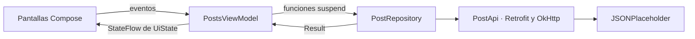
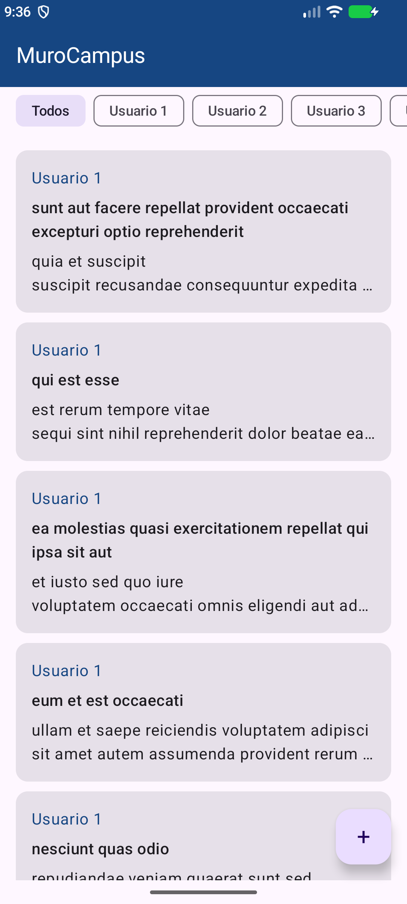
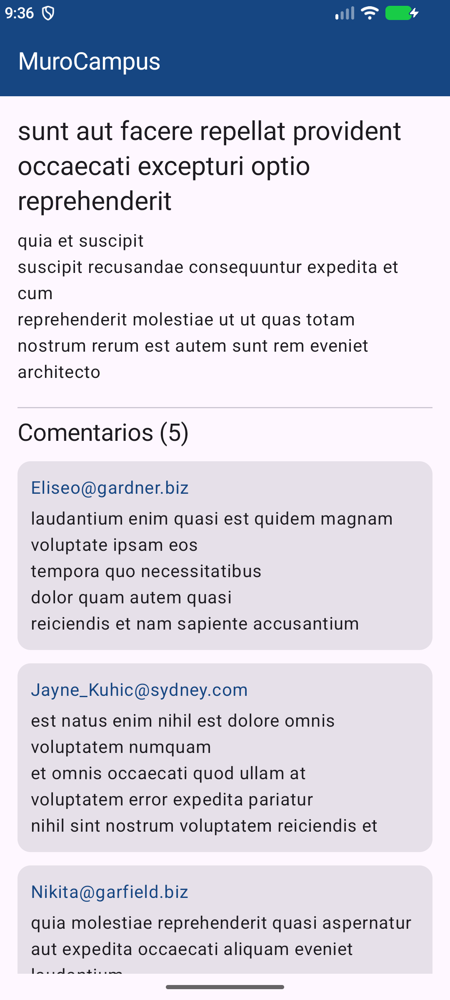
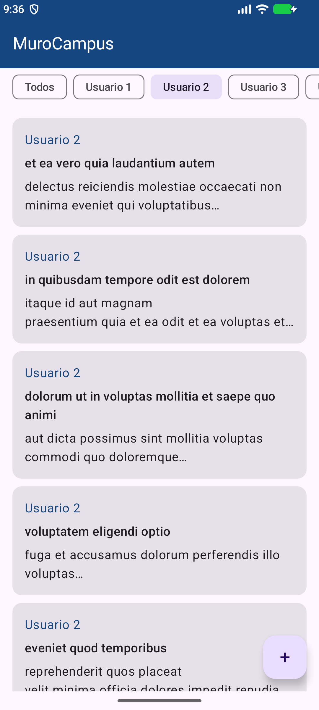
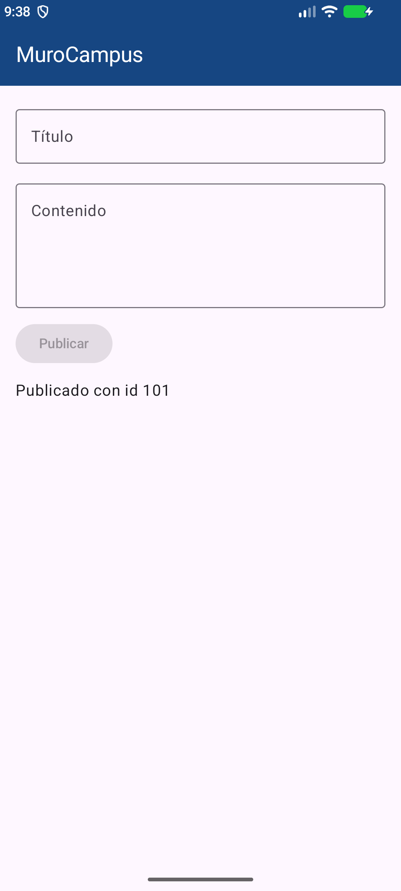
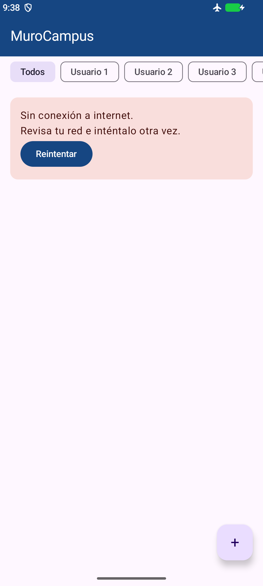

# MuroCampus

Aplicación Android de práctica para el laboratorio 09 de Programación en Móviles. Usa Jetpack Compose, Retrofit, OkHttp y JSONPlaceholder para listar publicaciones, consultar comentarios, filtrar por usuario y simular la creación de una publicación.

Esta implementación asistida se creó en un repositorio vacío. El proyecto de arranque se preparó desde cero con Gradle Wrapper y Android SDK 35.

## Ejecutar

Abre el proyecto en Android Studio, sincroniza Gradle y ejecuta `app` en un emulador o dispositivo con Android 7.0 o superior. Desde la terminal puedes crear el APK de depuración con `./gradlew assembleDebug` o `.\gradlew.bat assembleDebug` en Windows.

## Estructura

```text
com.tecsup.murocampus/
├── MainActivity.kt                  Composición de dependencias y navegación
├── model/Modelos.kt                 Post, Comentario y NuevoPost
├── data/
│   ├── PostRepository.kt            Contrato, implementación remota y errores
│   └── remote/                      PostApi y RetrofitClient
├── viewmodel/                       UiState, PostsViewModel y su fábrica
└── ui/                              Componentes y pantallas de lista, detalle y creación
```



## Capturas

| Lista | Detalle | Filtro por usuario | Crear | Error de conexión |
|---|---|---|---|---|
|  |  |  |  |  |

## Comprobaciones

En el emulador se verificaron la lista, el detalle con cinco comentarios, el filtro de usuario 2, la publicación con ID 101 y el regreso a la lista mediante **Reintentar** después de recuperar la conexión.

La API de práctica devolvió 100 publicaciones, cinco comentarios para la publicación 1, diez publicaciones para el usuario 2 y HTTP 404 para un ID inexistente. El POST de prueba devolvió el ID 101.

## Para pensar

1. **GET y POST.** GET permite consultar recursos. POST envía datos para que el servidor procese una acción, como crear una publicación. `@Body` serializa el objeto `NuevoPost` en el cuerpo de la solicitud. `@Query` agrega `userId` a la URL para filtrar la lectura.
2. **Ruta relativa.** `posts` se resuelve respecto del directorio de la URL base. Una ruta con barra inicial reinicia la ruta en la raíz del host. Con la URL base de este laboratorio ambas rutas apuntarían al mismo lugar, pero la diferencia importa si la base incluye un prefijo como `/api/v1/`.
3. **Result en el repositorio.** Permite convertir el éxito o el fallo de la operación en datos que el ViewModel transforma a `UiState`. El repositorio encapsula la comunicación HTTP y propaga la cancelación de la corrutina.
4. **Permiso y campos extra.** Sin `INTERNET` la app carece de permiso para hacer conexiones. Con la configuración estricta de kotlinx.serialization, una propiedad desconocida puede causar un error de deserialización. `ignoreUnknownKeys` permite aceptar campos adicionales.
5. **Estados excluyentes.** Un `when` exhaustivo sobre `UiState` garantiza que la pantalla muestra carga, datos o error según el único estado vigente. Tres variables independientes podrían representar combinaciones contradictorias.
6. **Servicio real.** Con un backend persistente, el POST devolvería el recurso guardado. La app podría mostrarlo en una lista compatible con el filtro vigente o volver a consultar al servidor y contemplar su paginación, permisos y errores.
